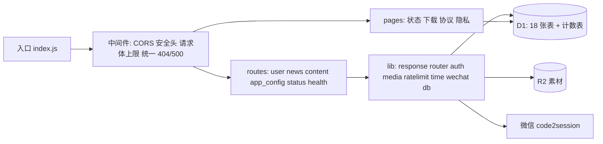

## 产品概述

按 `app/api-cf/Plan.md` 的规格，把 `app/api-cf` 从"只有文档与脚本"建成一个**完整的、可部署的 Cloudflare Workers 项目**，一次做完：33 条对外接口逐条对等实现（响应体与旧站逐字一致）、D1（既有 18 张表 + 限流计数表）、R2 素材（读公开域、上传走 Worker 中转）、微信登录，以及 4 个静态页。**本次只构建与本地自测，不部署、不改旧后端与小程序。**

## 核心功能

- **对外 API 33 条**：用户 9 条（登录、取资料、改资料、头像上传、注销、注销后处理、收藏/点赞/历史列表）、笔记 9 条（列表、详情、点赞、收藏、分享、留言、评论列表、行为状态、批量点赞态）、内容 6 条（轮播图、户外、摩旅、公告、未读数、标记已读）、配置 1 条（小程序整包配置）、状态与探针 8 条（状态页、三个 301 重定向、连通探测、health、health/ready、metrics 位）
- **行为对等**：成功码 200（轮播图为 0）、错误码与中文文案逐字一致、分页字段与 `has_more` 口径一致、`/news/list` 不带 `page` 时只回数组、公告与整包配置用 `message` 键
- **鉴权**：`users.token` 查库校验，token 来源 body/query 优先、`Authorization: Bearer` 兜底
- **素材**：库内相对路径 → 响应拼 `media.250036.xyz` 绝对地址；缩略图查得到才用、查不到回退原图；头像上传 multipart 经 Worker 中转写 R2
- **限流**：D1 计数表实现点赞/收藏 60、分享 30、留言 20、浏览历史 120（每分钟）、头像上传 5/60、登录失败 5 次锁 900 秒，超额 429
- **静态页 4 个**：状态页（含 `?format=json`）、下载页、用户协议、隐私政策（正文从 D1 `app_texts` 读取渲染，不硬编码）

## 约束

- 不迁管理功能；不引入运行时依赖；本次不执行任何部署/建库命令；`fastapi/`、`backend-cf/`、`lyjx/` 一行不动（小程序端保持"零改动、只切线路"）

## 技术栈选择

| 层 | 选型 | 依据 |
| --- | --- | --- |
| 运行时 | Cloudflare Workers（ES Module，`main = src/index.js`） | 旧站是纯 HTTP 接口，Workers 的 Web 标准 API（`fetch`/`crypto`/`FormData`）足够 |
| 数据库 | D1，绑定名 `DB`，库名 `lyjxxapp-api` | 建表脚本 `schema/0001_schema.sql` 已就绪（18 张表 / 45 条索引，由旧库真实 DDL 直出） |
| 限流 | D1 计数表 `rate_limit_counters`（`schema/0002_rate_limit.sql`） | 免费套餐无 Durable Objects，方案已在 `notes/limits-design.md` 定稿 |
| 素材 | R2，绑定名 `MEDIA`；读走 `media.250036.xyz` | key 与库内相对路径一致，数据库字段不改 |
| 静态页 | 先由同一 Worker 路由提供，同时保留 `pages/` 目录 | 零额外部署面；将来可单独 `wrangler pages deploy` |
| 自测 | `node --test`（`node:test` + `node:assert`） | 参照 `backend-cf/tests/*.test.mjs` 的 env 桩写法，零测试框架依赖 |


## 实现思路

**总体策略**：以 `notes/api-inventory.md`（33 条接口台账，含行号依据）为唯一契约来源，逐条"照抄行为、重写实现"；接口按模块拆成 `src/routes/*.js`，通用能力下沉到 `src/lib/*.js`。

**关键决策**

1. **响应壳必须支持两种形态**：`backend-cf/src/lib/response.js` 的 `ok()` 统一用 `msg` 键，而旧站存在 `message` 键与 `code=0`、只回 `{code,data}`、附 `status:'success'` 等特例。因此新项目的 `lib/response.js` 需要显式提供 `ok()`、`message()`（`{code,message,data}`）、`bare()`（只有 code+data）、`legacy()`（`{code,message,status,data}`）四种构造，避免实现时到处手拼对象。这是"小程序零改动"的关键，也是最容易写错的地方。
2. **分页口径按接口分别实现，不抽象成一套**：用户侧列表 `has_more = 行数 >= page_size`，`news/list` 与公告按 `total` 计算，评论走 `pagination.has_more`。三者不一致是旧站事实，抽象只会引入偏差。
3. **写路径用原子自增 + 唯一索引兜底**：`UPDATE news SET likes = likes + 1` 而非读改写；点赞/收藏/分享/浏览历史的重复由既有唯一索引（`news_likes_uniq` 等）保证不产生重复行。
4. **限流用"读一次 → 判 → 与业务写入同批"**：每条受限写操作多 1 行读 + 1 行写（D1 免费额度 5M 读 / 100k 写每日，余量充足）；登录锁定复用同一张表，成功登录 `DELETE` 清零。
5. **时间一律 +08:00**：`lib/time.js` 提供 `now()` / `toEpoch()`；`publish_time` 是库内字符串，原样透传不格式化。
6. **不引入任何运行时依赖**：Workers 里只用 Web 标准 API；R2 读写走绑定（上传中转），不需要 S3 凭据与签名逻辑。

**性能与可靠性**

- 列表接口只查不生成缩略图；缩略图存在性判定用一次批量查询，避免逐条探测（旧站 `existing_news_cover_thumb` 的等价实现）。
- 写接口的"限流计数 + 业务写 + 计数自增"放进一次 `env.DB.batch()`，把往返从 3 次降到 2 次（1 次限流读 + 1 次 batch）。
- 免费套餐 CPU 时间有限，留言正文净化只用轻量正则（限制 500 字），避免复杂解析。
- 所有 D1 访问包 try/catch，数据库不可用时按旧站返回「服务繁忙」而非栈信息。

## 实施要点

- **对等的坑要一次写对**：`/content/get_banners` 的 `code=0`、`/config/get_app_config` 与 `/content/get_notices` 的 `message` 键、`/news/list` 无 `page` 只回数组、`/apitest` 额外带 `timestamp`、301 重定向的 `Location` 目标。
- **注释规范**（用户强约定）：中文、一行一句、不写多行注释块、不写历史编号与日期。
- **只在 `app/api-cf/` 内新增文件**；`Plan.md`、`schema/`、`notes/`、`scripts/` 三个现成脚本保持不动（仅在 `README.md` 里引用它们）。
- **`database_id` 留占位**：配置里写 `database_id = ""`，并在 `README.md` 明确写出"用户执行 `wrangler d1 create lyjxxapp-api` 后回填"的步骤；同时说明账号内 D1 库已用 9/10。

## 架构设计



分层：入口与中间件 → 路由模块（每条路由只管取参与组装响应）→ 基础设施（响应壳、鉴权、素材地址、限流、时间）→ 平台绑定（D1、R2）。

## 目录结构

```
app/api-cf/
├── wrangler.toml               # [NEW] name=api-cf, main=src/index.js, d1 绑定 DB(lyjxxapp-api, id 占位), r2 绑定 MEDIA, vars(MEDIA_BASE/APP_VERSION/DEV_WECHAT_MOCK), observability 开启
├── package.json                # [NEW] 仅 scripts: test(node --test tests/*.test.mjs)、dev(wrangler dev --local); 无运行时依赖
├── README.md                   # [NEW] 跑起来/跑测试/建库并回填 database_id/本地 d1 初始化/部署步骤/免费额度提醒
├── src/
│   ├── index.js                # [NEW] 入口: 路由分发、统一 404 与 500、CORS/安全头/请求体上限、把 query 并入 body
│   ├── lib/
│   │   ├── response.js         # [NEW] ok/message/bare/legacy/fail/errorJson 五种构造, 集中所有码与中文文案
│   │   ├── router.js           # [NEW] 极简路由表(方法+路径精确匹配), 支持多方法注册
│   │   ├── db.js               # [NEW] D1 查询薄封装(first/all/run/batch)与统一异常转 503
│   │   ├── auth.js             # [NEW] token 提取(body/query/Bearer)与查库校验, 返回 userId 或错误对象
│   │   ├── media.js            # [NEW] 相对路径转绝对地址(MEDIA_BASE)、缩略图路径与存在性判定、历史域名归一化
│   │   ├── paging.js           # [NEW] 页码/页大小归一化与上限(50/20/10 三种口径由调用方传参)
│   │   ├── ratelimit.js        # [NEW] D1 计数表: check(scope,key,limit,window) 读判 + 与业务同批写入
│   │   ├── time.js             # [NEW] +08:00 时间与 Unix 秒转换
│   │   ├── wechat.js           # [NEW] code2session、access_token 获取与缓存、DEV_WECHAT_MOCK 联调分支
│   │   └── html.js             # [NEW] 静态页外壳(移动端适配、统一页头页脚)
│   ├── routes/
│   │   ├── user.js             # [NEW] 9 条: login get_user_info update_profile upload_avatar delete_account deleted_account_action user_favorites user_likes user_view_history
│   │   ├── news.js             # [NEW] 9 条: list detail like favorite share add_comment get_comments check_user_action check_user_like_batch
│   │   ├── content.js          # [NEW] 6 条: get_banners get_outdoor get_motorcycle get_notices get_notice_unread notice_read
│   │   ├── app_config.js       # [NEW] 1 条: get_app_config(categories/home_sections/featured/version/texts/menu + timestamp)
│   │   ├── status.js           # [NEW] 5 条: / /test /index /info /apitest(含 format=json 与 301)
│   │   └── health.js           # [NEW] 3 条: /health /health/ready /metrics(返回可用性状态, 不接 Prometheus 文本时给最小文本)
│   └── pages/
│       ├── status.js           # [NEW] 状态页(HTML), 含 ?format=json
│       ├── download.js         # [NEW] 下载页
│       ├── terms.js            # [NEW] 用户协议: 正文从 D1 app_texts 按 key 读取渲染
│       └── privacy.js          # [NEW] 隐私政策: 同上
└── tests/
    ├── user.test.mjs           # [NEW] 用户 9 条 + 鉴权 401/403 文案 + 头像上传(R2 桩)
    ├── news.test.mjs           # [NEW] 笔记 9 条: 列表两种分页口径、详情字段、写路径自增与唯一索引、评论分页结构
    ├── content_config.test.mjs # [NEW] 6 条内容 + 整包配置: code=0 特例、message 键、公告已读与未读数
    ├── status_health.test.mjs  # [NEW] 状态页/301/apitest/health/静态页与协议正文渲染
    └── ratelimit.test.mjs      # [NEW] D1 计数表: 上限拦截、跨窗口重置、按用户隔离、登录锁定与成功清零
```

## 关键代码结构

```js
// src/lib/response.js —— 旧站响应壳的全部形态, 集中在一处避免手拼
export const ok = (data = null, msg = 'success') => ({ code: 200, msg, data });
export const message = (data, text) => ({ code: 200, message: text, data });   // 整包配置 / 公告
export const bare = (data) => ({ code: 200, data });                          // /news/list 无 page
export const legacy = (data, text) => ({ code: 200, status: 'success', message: text, data });
export const fail = (code, msg, data = null) => ({ code, msg, data });
```

```js
// src/lib/ratelimit.js —— 读判一次, 计数自增由调用方放进同一个 batch
export async function check(env, { scope, key, limit, windowSec })
  // 返回 { allowed: true } 或 { allowed: false, retry_after }
export function bumpStatement(env, { scope, key, windowSec })
  // 返回一条可放进 env.DB.batch([...]) 的 upsert 语句
```

## 设计风格

4 个页面（状态、下载、协议、隐私）走**极简文档风**：以可读性优先，移动端单列布局、正文最大宽度约 720px 居中，无装饰插图，靠留白与字重分层。协议与隐私是长文，须保证行高与对比度适合长时间阅读；状态页用一张信息卡片呈现服务名、版本、时间与健康状态，与整站接口返回的信息一致。

## 页面构成（每页自上而下）

- **状态页**：页头（服务名 + 版本徽标）→ 状态卡片（运行状态 / 服务器时间 / 数据库连通）→ 接口可用性列表（几个关键接口的点亮状态）→ 页脚（版本与时间）。支持 `?format=json` 时直接返回 JSON。
- **下载页**：页头（同名页头复用）→ 主行动区（小程序码/下载入口 + 一句话说明）→ 使用说明要点列表 → 页脚（协议与隐私入口）。
- **协议页**：页头 → 文档标题与更新时间 → 正文（从 D1 `app_texts` 读取，保留段落换行）→ 返回顶部 → 页脚。
- **隐私页**：与协议页同构，仅正文来源 key 不同；两页共用同一个文档外壳，视觉完全一致。

## 交互与响应式

- 仅必需交互：链接、返回顶部、`?format=json`；不引入任何脚本依赖，页面为服务端渲染的静态 HTML。
- 移动端优先：单列、正文 16px、行高 1.75；桌面端内容居中并加左右留白，不出现横向滚动。
- 正文取不到（D1 无对应 key）时显示兜底文案而不是报错页。

## Agent Extensions

### SubAgent

- **code-explorer**
- Purpose: 在实现读路径与用户模块前，精读旧站 `fastapi/app/api/news.py`、`content.py`、`user.py` 与 `app/core/` 相关实现的真实字段与分支（分页口径、`code=0` 特例、留言免审判定、注销状态机、资料回填），并确认 `app_texts` 里协议/隐私的 key 名
- Expected outcome: 一份带行号的字段与分支清单，直接驱动实现，避免凭文档摘要臆测导致响应体不一致

### Skill

- **ponytail**
- Purpose: 约束实现规模——不引入运行时依赖、不为 33 条接口抽不必要的抽象层、不做用不上的配置项；每处刻意简化写明升级路径
- Expected outcome: 交付物只覆盖"对外 API 迁移"这一件事，文件与代码行数最小化，且关键简化点有据可查