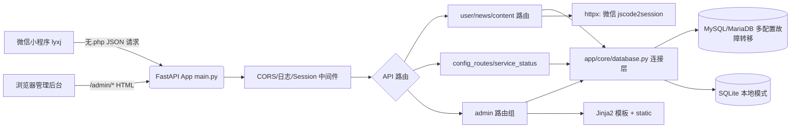

## 产品概述

将「狼牙极限运动笔记」微信小程序后端从 PHP(api/ 目录) 迁移为 FastAPI 实现，新代码整体保存到 fastapi/ 目录。属于纯技术栈迁移任务：不改动业务规则、数据库表结构语义与对外数据契约，同时保证新工程结构清晰、可独立运行。

## 已确认的迁移范围（经用户确认）

- JSON 小程序接口（19 个）：user/ 7 个、news/ 9 个、content/ 3 个；另加 config/get_api_routes 动态线路配置、根服务状态接口（/、/index?format=json、/test、/apitest、/info 的 JSON 部分）。
- 管理后台 admin/ 全部管理功能（用户、管理员、新闻、轮播图、摩旅/户外专题、评论、设置、上传、系统工具、数据库工具、测试页等），用 HTML 模板重写，保留原网址形态与页面结构；api/h5 与 api/cloudflare-d1 不迁移。
- 接口路径去掉 .php 后缀（如 /user/login.php -> /user/login），保持其余路径结构不变，并同步修改小程序前端 lyxj/app.js 的调用路径。
- 数据库：默认连接 MySQL/MariaDB（保留多配置自动故障转移思路，配置可用环境变量覆盖）；额外支持 SQLite 模式，便于无 MySQL 环境下本地直接运行调试，需配套两套建表 SQL。

## 核心要求

- 逐接口保持原有请求参数（字段名、类型、位置）、响应结构与业务逻辑不变；包括不同接口间 code 值差异（如 get_banners 成功为 0、多数接口为 200）与字段名差异（msg/message）也需原样保留。
- 保留中文提示文案、分页规则、审核/防重复/计数回写等逻辑；保留默认管理员 admin/123456。
- 产出 requirements.txt、运行说明、接口映射说明，并更新根 README.md 相应章节。

## 技术栈

- Python 3.10+ / FastAPI / Uvicorn（ASGI 服务）
- 模板：Jinja2（管理后台页面，复刻原 PHP 页面结构）
- 数据库：PyMySQL（MySQL/MariaDB，多配置故障转移）+ 标准库 sqlite3（SQLite 本地模式）
- 依赖补充：python-multipart（表单/上传）、httpx（微信 jscode2session 等外部调用）、bcrypt（校验 PHP password_hash 存量密码）、itsdangerous（Starlette SessionMiddleware 签名 Cookie）、python-dotenv

## 实现思路

以现有 api/ 各 PHP 文件为唯一业务逻辑事实来源，逐文件翻译为 FastAPI：每个 PHP 文件对应一组同域路由与处理函数；数据库访问统一收敛到 app/core/database.py（每次请求经 FastAPI 依赖获取连接、try/finally 释放）；响应统一收敛到 app/core/response.py，但各接口保留各自原始 code/msg 字段与取值，不做格式归一化。管理后台以「路由 + Jinja2 模板」重写，登录态使用签名 Cookie Session（admin_logged_in/admin_id/admin_username/admin_role），AJAX 未登录返回 {code:403,msg:...}、页面请求 302 到登录页，与 admin_check.php 行为一致。

## 关键决策与取舍

- **路径映射**：去掉 .php 后缀、保留目录层级；提供 README 映射表；同步修改 lyxj/app.js（19+1 处）与其 grep 出的残留 ".php" 调用点，保持前端可用。
- **SQL 方言兼容**：统一书写两库均可执行的 SQL（时间函数统一用 CURRENT_TIMESTAMP，占位符统一用 `?`，由 database.py 在 PyMySQL 侧自动转换为 %s）；仅在 schema_mysql.sql / schema_sqlite.sql 中区分 AUTO_INCREMENT/AUTOINCREMENT、字段类型等建表差异。
- **存量密码兼容**：账号登录保留「bcrypt(password_verify) 优先、md5 兜底」校验；命中 md5 后写回 bcrypt 哈希（符合 PHP 注释中的升级意图），客户端行为与 PHP 版一致。
- **微信登录本地可调试**：.env 提供 WECHAT_APPID/WECHAT_SECRET；当 secret 为空且开启 DEV_WECHAT_MOCK=true 时，用 code 派生固定 openid 走完整注册/登录链路，便于本地冒烟，生产关闭该开关。
- **上传路径**：头像/内容上传目录由 env UPLOAD_DIR 配置（默认 ./uploads/），返回字段与 PHP 版保持一致（默认头像 /images/user.jpg 等按原样保留字符串值，不硬编码服务器路径）。
- **管理后台静态资源**：从 api/admin/images 复制图片至 fastapi/app/admin/static，页面样式以内联 CSS/HTML 结构复刻为主，保证脱离 PHP 环境可直接运行。
- 不引入 ORM、不重构 SQL、不改表结构，最大限度控制迁移回归风险。

## 实施要点

- 逐接口核对响应差异矩阵（如 news/list 无 msg 字段、get_banners 成功 code=0、get_api_routes 用 message 且带 timestamp/version、test.php 结构带 timestamp），实现时以原文件为准逐字段对照。
- 登录、点赞/收藏、分享等涉及计数回写/事务/防重复的接口必须保留事务与唯一性判断，不得因迁移引入竞态。
- 管理后台「列表筛选与分页参数保持、操作后重定向携带 message、批量操作、CSRF token」等交互按原 PHP 页面行为复刻。
- admin 的 news/news_edit 等富文本内容页沿用原字段（title/content/category/cover/images/video/status 等）与编辑流程。
- 日志复用 logging 模块按原 error_log 位置输出（登录/微信回调/异常），避免泄露密码与 secret；日志可配级别。
- 只新增 fastapi/，修改 lyxj/app.js 与根 README.md；api/ 与其余文件保持不动，避免无关改动。

## 架构设计



- API 层只做参数解析与响应封装，业务 SQL 与 PHP 原样对应，模块间通过 core 依赖注入，便于单测与替换数据源。
- 管理后台由 auth(登录/登出) 与各业务模块路由组成，全部路由先经 deps.require_admin 鉴权。

## 目录结构

```
fastapi/                                  # [NEW] FastAPI 后端根目录
├── main.py                               # [NEW] 应用入口：创建 app、CORS 中间件、Session 中间件、静态挂载、注册全部路由、启动时按需建表
├── requirements.txt                      # [NEW] fastapi/uvicorn/jinja2/PyMySQL/bcrypt/python-multipart/httpx/itsdangerous/python-dotenv
├── .env.example                          # [NEW] DB_DRIVER/DB_HOST/DB_PORT/DB_USER/DB_PASSWORD/DB_NAME/多DB_*_*、WECHAT_APPID/WECHAT_SECRET、DEV_WECHAT_MOCK、UPLOAD_DIR、SECRET_KEY
├── README.md                             # [NEW] 迁移说明、启动命令(uvicorn main:app --reload)、.php->无后缀接口映射表、SQLite/MySQL 切换说明
├── app/
│   ├── __init__.py                       # [NEW] 包初始化
│   ├── core/
│   │   ├── __init__.py
│   │   ├── config.py                     # [NEW] 读取 .env/环境变量，输出统一配置对象（数据库配置数组、微信、上传、会话密钥）
│   │   ├── database.py                   # [NEW] 连接层：MySQL 多配置依序尝试+故障转移、SQLite 模式、?占位符适配、get_db 依赖、schema 自动初始化与种子写入
│   │   ├── response.py                   # [NEW] success/error 辅助（仅规范拼装，不统一 code 语义，各接口自行决定 code/msg/message）
│   │   ├── security.py                   # [NEW] bcrypt/md5 密码校验与升级、管理员 Session 依赖 require_admin、CSRF token 辅助
│   │   ├── logging.py                    # [NEW] 日志封装（对应 error_log，隐藏 secret）
│   │   └── wechat.py                     # [NEW] httpx 封装 jscode2session；DEV_WECHAT_MOCK 分支
│   ├── api/
│   │   ├── __init__.py
│   │   ├── service_status.py             # [NEW] GET /、/index(支持?format=json)、/test、/apitest、/info：复刻 HTML/JSON 双形态与 api_status/version/timestamp 字段
│   │   ├── config_routes.py              # [NEW] GET /config/get_api_routes(?debug=1)：静态 4 条线路配置、getActiveRoutes 排序、message 字段响应、debug 输出
│   │   ├── user.py                       # [NEW] POST /user/login(wechat/account)、/user/get_user_info、/user/update_profile、/user/upload_avatar、/user/user_favorites、/user/user_likes、/user/user_view_history（token 校验、分页、字段原样）
│   │   ├── news.py                       # [NEW] /news/list、/news/detail、/news/like、/news/favorite、/news/share、/news/add_comment、/news/get_comments、/news/check_user_action、/news/check_user_like_batch（事务/防重复/审核/计数回写原样保留）
│   │   └── content.py                    # [NEW] /content/get_banners(position/limit 1-10)、/content/get_outdoor、/content/get_motorcycle（status 过滤与排序一致，banners 成功 code=0）
│   ├── admin/
│   │   ├── __init__.py
│   │   ├── deps.py                       # [NEW] require_admin 依赖（Session 校验，AJAX 403 JSON / 页面 302）
│   │   ├── auth.py                       # [NEW] /admin/login(自动初始化 admin_users 与默认管理员 admin/123456)、/admin/logout
│   │   ├── dashboard.py                  # [NEW] /admin、/admin/dashboard 统计与系统信息页
│   │   ├── users.py                      # [NEW] /admin/users、/admin/user_detail、/admin/admin_users、/admin/user_news_manage（特权用户、分页、审核）
│   │   ├── news.py                       # [NEW] /admin/news_manage、news_edit、news_delete、news_copy、news_preview、news_batch_action、news_update_status(AJAX)
│   │   ├── banners.py                    # [NEW] /admin/banner_manage、banner_edit、banner_delete、banner_copy
│   │   ├── topics.py                     # [NEW] /admin/motorcycle_manage、motorcycle_edit、motorcycle_preview、outdoor_manage、outdoor_edit、outdoor_preview
│   │   ├── comments.py                   # [NEW] /admin/comments_manage（筛选、审核、批量）
│   │   ├── settings.py                   # [NEW] /admin/settings(改密)、/admin/system_info、/admin/admin_upload、/admin/gitee_proxy(可配置域名白名单)
│   │   ├── maint.py                      # [NEW] /admin/check_db、fix_db、test_database、add_email_column、avatar_field_fix、check_users_table、test_upload、test_avatar_upload、test_image_loading、test_image_path、debug_upload（复刻诊断输出）
│   │   ├── templates/                    # [NEW] Jinja2 模板：base.html(原 layout.php+footer.php 合并)、login.html 及 users/news/banner/topic/comment/settings 等页，保持原页面结构与表单字段
│   │   └── static/                       # [NEW] 自 api/admin/images 复制的图片与内联样式补充
│   └── sql/
│       ├── schema_mysql.sql              # [NEW] 与 api/sql/*.sql 等价的 11 表+admin_users 建表（utf8mb4/InnoDB）
│       ├── schema_sqlite.sql             # [NEW] SQLite 方言版建表（AUTOINCREMENT/CURRENT_TIMESTAMP）
│       └── seed_admin.sql                # [NEW] 默认管理员 admin/123456(bcrypt) 种子
├── uploads/                              # [NEW] 运行时上传目录（.gitignore）
└── tests/
    └── smoke_test.py                     # [NEW] SQLite 模式冒烟：接口响应结构、登录、点赞/收藏/评论、admin 登录与 CRUD
```

受影响的外部文件：

```
lyxj/app.js                               # [MODIFY] globalData.api 中 19 个接口路径 + config/get_api_routes 调用去 .php；同时 grep 全目录其余 ".php" 调用点核对
README.md                                 # [MODIFY] 项目结构增补 fastapi/、技术栈说明（FastAPI 迁移版）、部署/运行指引
```

## 关键代码结构

路由注册与依赖（示意）：

```python
# main.py
app = FastAPI(title="狼牙极限运动笔记 API (FastAPI)")
app.add_middleware(SessionMiddleware, secret_key=settings.secret_key)
app.include_router(user.router)        # POST /user/login 等
app.include_router(news.router)        # GET /news/list 等
app.include_router(content.router)     # GET /content/get_banners 等
app.include_router(config_routes.router)
app.include_router(service_status.router)
app.include_router(admin.router, prefix="/admin")
```

```python
# app/core/database.py（连接抽象，接口级）
def get_conn(): ...            # DB_DRIVER=mysql: 依配置数组逐个尝试连接并记录使用索引；=sqlite: sqlite3 连接
def query(conn, sql, params=()): ...  # ? 占位符统一，mysql 侧自动转 %s，返回 dict 行列表
def get_db():                 # FastAPI 依赖：yield conn，finally 关闭
def init_schema(conn): ...    # 启动时按方言执行 schema_*.sql 与种子（幂等）
```

## Agent Extensions

### SubAgent

- **code-explorer**
- 用途：在第一步全面盘点 api/ 全部 PHP 文件（user/news/content/config/admin 及 templates）、lyxj 前端全部 ".php" 调用点与 SQL 脚本，输出「接口/页面→FastAPI 路由」精确映射清单与逐接口响应格式差异矩阵（code 取值、msg/message 字段、分页与上传细节），作为后续迁移任务的事实基线。
- 预期结果：一份可核对的迁移映射与行为基线文档，直接驱动 todo 2-6 的实现与校验，避免漏迁或响应格式不一致。