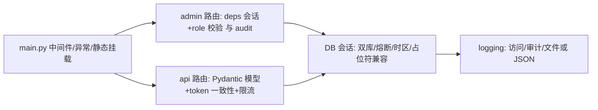

## 产品需求

在 `D:\Users\Administrator\Desktop\开发者\xapp\iitbt\迁移代码审查报告.md` 基础上，完成其中**全部未完成内容**（P0-1~P0-3、P1-4~P1-8、P2-9~P2-12 全部修复项，以及 G-1~G-12 全部改进建议），并在项目根目录新建 `修复报告.md`，逐项记录：已完成任务、发现的问题与对应修复措施、未解决事项及原因、后续建议，并附文件改动清单汇总。

## 已确认约束（用户澄清）

1. **修复范围**：P0~P2 全部遗漏 + G-1~G-12 全部横切改进，一次完成。
2. **凭据处理方式**：仅做代码加固——代码内默认凭据置空 + 启动 fail-fast 校验；**不修改 `fastapi/.env`**；真实微信 secret、数据库口令等由用户后续按修复报告中的清单自行填写。
3. **验收方式**：只改代码并产出报告，**不执行** smoke_test、uvicorn 等任何运行验证或写操作。
4. 禁止执行任何会修改系统状态的命令；不得修改 `.env`、不得连接远程生产库执行写操作。

## 核心修复内容（按报告编号）

- **P0-1/P0-2**：配置层凭据脱敏 + 启动校验（微信 secret 为空且未显式开启 mock 时报错；SECRET_KEY 为空或为已知占位值时拒绝启动）；清理 git 跟踪文件 `app/core/config.py`、`api/config/database.php`、`api/config/wechat.php`、`fastapi/.env.example` 中的真实凭据。
- **P0-3**：补 `/admin/gitee_proxy` 图片代理路由（域名白名单、Referer、original 直链参数，防 SSRF）。
- **P1-4/P1-5/P1-6**：`news_copy` 补路由注册；`banner_copy` 保留源行字段；`user_news_manage` 补 `user_id` 过滤与状态默认值。
- **P1-7**：媒体/静态目录容错与启动告警、图片域名白名单补齐。
- **P1-8**：写接口强制 token 解析用户与请求 `user_id` 一致。
- **P2-9~P2-12**：maint SQL 工具页、`tools/sync.py` 同步脚本、默认管理员口令统一、错误字段与方法白名单收敛。
- **G-1~G-12**：会话安全与角色鉴权、全局异常处理、限流、时区收敛、连接超时与熔断、性能清理、Pydantic 校验、测试补强、日志审计、信息最小化、文档同步、双库兼容层加固。

## 交付物

- 全部代码修改（仅限 `fastapi/` 与 `api/config/*.php` 脱敏、根 README、根 `修复报告.md`）。
- 根目录新增 `修复报告.md`（Markdown，结构清晰、便于阅读追踪）。

## 技术栈

- 沿用现有架构，不做技术栈替换：FastAPI + uvicorn、PyMySQL（MySQL 多配置故障转移）、内置 sqlite3（本地调试）、Jinja2 管理后台、Starlette SessionMiddleware、passlib/bcrypt（现有 `app/core/security.py`）、Python 3.10+（zoneinfo 可用）。
- 不新增重依赖（不引入 SQLAlchemy/DBUtils/slowapi），横切能力优先用标准库 + 轻量自研实现，控制风险与体积。

## 实现方案

### 总体策略

按"配置安全 → 基础设施（数据库/日志/会话）→ 后台功能修复 → 对外 API 层 → 测试与文档"的顺序推进。先做配置层 fail-fast 与凭据脱敏，保证后续所有模块在无真实密钥时能安全失败；再修复各业务差异；最后统一补测试与文档，并生成 `修复报告.md`。

### 关键技术决策

1. **凭据脱敏 + 启动校验**：`config.py` 内置 MySQL 口令、微信 secret、真实 appid 全部置空（appid 保留占位），`SECRET_KEY` 默认置空；`Settings()` 末尾执行 `validate()`：①`wechat_secret` 为空且 `DEV_WECHAT_MOCK` 非显式 true → 抛 RuntimeError（提示填写）；②`secret_key` 为空或等于已知占位值 → 抛 RuntimeError（提示用 `secrets.token_hex(32)` 生成）。已知当前 `.env` 使用占位 SECRET_KEY，修复后本地启动会失败，属预期行为，需在报告中列为"待用户手动填写"事项并给出模板。
2. **双库默认口令统一**：新增 `ADMIN_INIT_PASSWORD` 环境变量，`seed_default_admin` 默认值对齐 PHP 的 `admin`，`.env.example`/README 注明并提示首登修改。
3. **数据库层**（database.py）：新增 `local_now/today_str` 统一使用 `zoneinfo("Asia/Shanghai")`（提供 `app/core/timeutil.py`），替换依赖进程本地时区的实现；`connect_timeout` 改可配置（`DB_CONNECT_TIMEOUT`，默认 3s）；新增线程安全的内存熔断缓存（host:port → 失败时间戳，TTL 30s 可配），失败主机在 TTL 内跳过直连避免每请求串行等 20s；**不引入连接池**——保持每请求短连接与 PHP PDO 语义一致，取舍写入 README 与修复报告；G-12 占位符替换改为括号感知、脚本切分识别字符串引号，避免误替换。
4. **会话与鉴权**（G-1）：SessionMiddleware 设置 `max_age=86400`、`same_site="lax"`、`secure` 由 `COOKIE_SECURE` 可配；`admin_users` 增加 `role` 列（双库 `add_column` 幂等自愈，默认 `normal`，启动自愈将 `username='admin'` 行置为 `super`）；`super_admin_guard` 从"用户名==admin"改为校验 `role in ('super','admin')`；登录失败按 IP+用户名计数，超过阈值（默认 5 次/15 分钟）锁定并提示。
5. **日志审计**（G-9）：`logging.py` 支持 `LOG_FILE`、`LOG_FORMAT=json|text`；新增访问日志中间件（路径/状态/耗时/来源 IP）；后台写操作经 `audit` logger 输出审计日志，logger 名称含操作者与动作。
6. **后台功能修复**（P1-4/5/6、P2-9）：严格对照 PHP 参考实现；`news_copy` 补装饰器与参数；`banner_copy` 复制源行全部业务字段（仅重置 id）；`user_news_manage` 支持 `user_id` 与状态默认 `all`；`maint.py` 新增受 `super_admin_guard` 保护并写审计的 SQL 工具页（执行只读查询或受白名单约束的写语句）。
7. **gitee_proxy**（P0-3）：新建 `app/admin/gitee_proxy.py` 路由模块，httpx 异步代理；严格域名白名单（gitee.com/assets.gitee.com/img.picui.cn/nsw.iitbt.cn + 当前站点域名）+ 端口限制 + 超时 + `original=1` 直链与原 Referer 头逻辑，与既有后台鉴权依赖保持一致，模板 `test_image_loading` 引用路径不变。
8. **对外 API 层**（P1-8、G-2/G-3/G-6/G-7/G-10、P2-12）：写接口（点赞/收藏/分享/评论/浏览记录/check_user_action 等）复用 user.py 既有 token 解析工具，强制 token 存在且解析 user_id 与请求体一致（不一致返回统一 401/403 风格错误，保留字段兼容旧客户端）；`check_user_like_batch` 错误响应移除多余 `error` 字段；登录/get_user_info 响应改字段白名单；`content.py` 删除冗余二次排序与 `debug_info.ids`；`news/list` 增加可选 `page/page_size`（缺省保持原全量行为）；新建 `app/api/schemas.py` 定义 Pydantic 请求模型（`news_ids` 上限 200、id 边界校验）；main.py 注册全局异常 handler（对外 `{code:500,msg:"服务器错误，请稍后重试"}`，详情仅进日志），清理各路由 `f"服务器错误: {exc}"` 回显；新增轻量内存限流依赖（登录 IP+用户名、写接口 IP+user_id，阈值可配，注明单进程限制）。
9. **媒体/静态**（P1-7）：main.py 在媒体目录缺失时启动打印醒目 warning（不阻断启动）；uploads 自动创建保留；`LEGACY_IMAGE_HOSTS` 白名单补当前实际站点域名（nsapi.250036.xyz 等）；静态默认图缺失仅告警并在报告中给资源迁移清单（不虚构素材文件）。
10. **同步脚本**（P2-10）：新增 `fastapi/tools/sync.py` CLI，对照 `api/config/database_sync.php` 语义迁移；默认只读校验、目标库写入需显式 `--target` 参数并写审计日志。
11. **测试**（G-8）：扩展 `tests/smoke_test.py`（在导入 app 前自行设置安全 SECRET_KEY 与 mock 开关，适配新校验），覆盖：news_copy 已注册、banner_copy 字段保持、user_news_manage user_id 过滤、check_user_like_batch 无 error 字段、config 校验抛错分支、gitee_proxy 白名单拒绝、DB 工具（占位符转换/脚本切分/时区）。只编写不运行。
12. **文档**（G-11）：根 README 改为 FastAPI 为主后端说明，同步 fastapi/README.md；`.env.example` 与 config 注释一致化并脱敏；`api/config/*.php` 脱敏为占位符 + 注释。

## 实现注意事项

- **不修改 `fastapi/.env`**：本次改动后，依赖内置默认凭据的 MySQL 连接与占位 SECRET_KEY 将不再可用，必须在 `修复报告.md` 中提供"上线前手动填写清单"（.env 模板占位、不写真实值，避免新报告再次泄密），并提示先轮换已泄露口令。
- **兼容优先**：除明确删除的 `debug_info`、`error` 等调试/多余字段外，对外 JSON 结构与文案保持 1:1；`check_user_action` 保留 GET+POST 双方法（小程序端按 POST 调用，PHP 原 GET，收窄有回归风险，决策记录进报告）。
- **旧库自愈**：`role` 列与默认管理员口令变化均走幂等 add_column/UPDATE，不破坏既有 `admin_users` 数据。
- 不改动 `迁移代码审查报告.md` 原文，仅在 `修复报告.md` 中按编号逐项引用，避免歧义。

## 架构设计

修改全部发生在现有分层内（core 基础设施 / admin 后台 / api 对外层 / tools 脚本），不引入新架构模式。数据流不变：请求 → 路由/依赖（鉴权、限流）→ 业务（DB 会话）→ 统一响应/异常 → 日志审计。



## 目录结构

```
iitbt/
├── 修复报告.md                              # [NEW] 本次交付报告(已完成/问题与措施/未解决/建议/改动清单)
├── README.md                               # [MODIFY] 改为以 FastAPI 为主后端; .env 必配项与部署说明
├── api/config/database.php                 # [MODIFY] 真实口令脱敏为占位符+注释
├── api/config/wechat.php                   # [MODIFY] 真实 secret/appid 脱敏
└── fastapi/
    ├── .env.example                        # [MODIFY] 脱敏、注释与 config 校验规则一致、默认管理员口令说明
    ├── main.py                             # [MODIFY] SessionMiddleware 参数、全局异常 handler、访问日志/媒体目录告警、挂载容错
    ├── README.md                           # [MODIFY] 同步新配置项与约束
    ├── tools/
    │   └── sync.py                         # [NEW] 数据同步/备份 CLI(默认只读, --target 显式写, 审计)
    ├── tests/smoke_test.py                 # [MODIFY] 注入安全 SECRET_KEY/mock; 补 G-8 全部断言(不运行)
    └── app/
        ├── core/
        │   ├── config.py                   # [MODIFY] 凭据置空+validate() fail-fast+ADMIN_INIT_PASSWORD+限流/超时/熔断 TTL 等可配项
        │   ├── database.py                 # [MODIFY] 时区/熔断缓存/connect_timeout 可配/括号感知占位符与脚本切分/seed 口令可配/role 自愈
        │   ├── timeutil.py                 # [NEW] Asia/Shanghai 统一时间工具(local_now/today_str/to_unix)
        │   ├── logging.py                  # [MODIFY] LOG_FILE/LOG_FORMAT、audit logger
        │   └── wechat.py                   # [MODIFY] 仅按需补充配置错误文案(无行为变更)
        ├── admin/
        │   ├── deps.py                     # [MODIFY] 会话参数校验配合; role 字段校验替换硬编码用户名
        │   ├── auth.py                     # [MODIFY] 登录失败限速+锁定
        │   ├── news_admin.py               # [MODIFY] news_copy 注册装饰器; user_news_manage user_id 过滤与状态默认
        │   ├── banners.py                  # [MODIFY] banner_copy 保留源行业务字段
        │   ├── gitee_proxy.py              # [NEW] 白名单图片代理路由(httpx+超时+original/Referer)
        │   └── maint.py                    # [MODIFY] 受 super_admin_guard 保护+审计的 SQL 工具页
        └── api/
            ├── schemas.py                  # [NEW] Pydantic 请求模型(news_ids 上限 200/id 边界等)
            ├── helpers.py                  # [MODIFY] LEGACY_IMAGE_HOSTS 补实际站点域名
            ├── news.py                     # [MODIFY] token 与 user_id 强校验/可选分页/时区换算/移除多余字段
            ├── user.py                     # [MODIFY] 白名单响应/token 一致性校验/时区换算
            └── content.py                  # [MODIFY] 去冗余排序与 debug_info.ids
```

## 关键代码结构

1. 配置校验契约（config.py 内 `validate()`，在 `Settings()` 构造末尾调用，缺失即抛错并给出可操作提示）：

```python
def validate(self) -> None:
    if self.db_driver == "mysql" and not self.mysql_configs:
        raise RuntimeError("DB_DRIVER=mysql 但未提供任何数据库配置，请在 .env 设置 DB_HOST/DB_USER/DB_PASSWORD 等")
    if not self.wechat_secret and not self.dev_wechat_mock:
        raise RuntimeError("WECHAT_SECRET 为空且未显式开启 DEV_WECHAT_MOCK=true，请填写真实密钥或显式开启 mock")
    if not self.secret_key or self.secret_key == "lyjx-fastapi-secret-change-me":
        raise RuntimeError("SECRET_KEY 缺失或为默认占位值，请用 secrets.token_hex(32) 生成并写入 .env")
```

2. 熔断器（database.py 内，线程安全、短 TTL）：

```python
class HostBreaker:
    def is_open(self, host: str, port: int) -> bool: ...
    def mark_down(self, host: str, port: int) -> None: ...
    def mark_up(self, host: str, port: int) -> None: ...
```

3. 请求模型示例（schemas.py）：

```python
class UserActionBody(BaseModel):
    token: str
    user_id: int = Field(ge=1)
    news_id: int = Field(ge=1)
```

## Agent 扩展

### SubAgent

- **code-explorer**
- 用途：跨 `api/` 与 `fastapi/` 大批量定位 PHP 参考实现（gitee_proxy.php、news_copy.php、banner_copy.php、user_news_manage.php、database_sync.php 等）与 fastapi 对应模块的精确差异，输出行为/参数对照摘要，供各修复任务直接落地，避免逐个手读文件。
- 预期结果：产出一份"PHP 参考行为 → fastapi 现状 → 修复点"对照清单（含文件行号、参数、默认值、响应/重定向语义），作为后续实现的唯一依据。