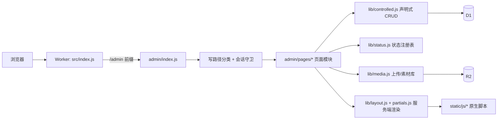

## 产品概述

把"狼牙极限运动笔记"的经营后台从旧的 FastAPI 服务端渲染后台，**完整迁移**到当前的 Cloudflare 版后端（与对外接口同一个 Worker、同一个域名），迁移后每个页面的功能、数据、权限、交互与旧后台保持一致。后台与对外接口在代码上分开管理，互不干扰。

## 核心功能

**内容管理**

- 轮播图：列表（按位置/状态筛选、触底加载）、新增/编辑、启用停用、复制、删除
- 通知公告：列表、新增/编辑（含生效起止时间、跳转页面、类型）、启用停用、删除
- 笔记分类：列表、新增/编辑、启停、删除（删除时展示影响面并选择是否把旧标识下的笔记一起迁移）
- 首页板块、首页精选：列表、新增/编辑、启停、删除；板块名称随分类自动派生
- 运营文案：列表、新增/编辑（多行正文原样保留）、启停、删除
- 我的页菜单：列表、新增/编辑（跳转类型/目标、登录可见/未登录可见、仅内部测试可见、排序）、启停、删除、补齐内置菜单项
- 版本更新配置：编辑最新版本号、最低版本号、更新提示与内容
- 专题精选（摩旅/户外）：分页列表、新增/编辑、预览、启停、删除

**用户与审核**

- 用户管理：关键词/状态/内部测试筛选、分页列表、用户详情、设为或取消内部测试、恢复已注销账号、删除、用户笔记管理
- 管理员管理：管理员列表与新增/编辑/删除
- 笔记管理：关键词/分类/状态筛选分页列表、新增/编辑（标题、简介、正文富文本、封面、视频、分类、排序、发布时间、活动时间）、预览、复制、删除、批量操作
- 笔记回收站：列表、还原、彻底删除（不可恢复）、批量操作
- 留言管理：分页列表、通过/拒绝、删除

**系统**

- 控制面板：笔记数、用户数、待审留言数、启用中公告数等统计
- 管理员设置：改自己的昵称/头像/口令
- 系统信息：版本、绑定与表行数等运行信息
- 全后台统一的状态切换（列表行内启停，按业务类型统计）

**权限（三级角色）**

- 角色分超级管理员 / 管理员 / 普通；删除、批量、复制、留言审核、用户笔记审核、用户管理写操作、管理员账号这几类**仅超管**可用
- 非超管看不到对应菜单项，直接访问会被拦回
- 每一条写操作都要登记权限归属，遗漏要在测试里被点名

**通用交互（所有列表页一致）**

- 首屏 3 页 + 滚动到底自动加载下一页、底部工具栏（回到顶部、页码直达）
- 搜索筛选条件在翻页、编辑后回列表时保留
- 删除与保存重复提交只提示一次、不重复落库
- 表单校验失败时回填已填内容并定位到出错字段

**上传与素材选择**

- 笔记封面、正文插图、轮播图共用同一个上传入口；视频与图片按字段区分类型
- 编辑页可从已有素材（图片/视频）中**点选**，不用手打长路径

**页面适配与质量**

- 桌面端侧栏常驻、小屏可抽屉展开；各列表与表单在手机宽度下可正常操作
- 页面加载失败有明确提示、不出现空白页或 500

## 不在本次范围

数据库管理与数据库工具、素材库治理页（查看占用/查引用/删素材）三页**本次不做**，需要时沿用 D1 控制台。

## 一、技术栈（沿用现状，不引入新依赖）

| 项 | 选择 | 理由 |
| --- | --- | --- |
| 运行时 | Cloudflare Workers（免费套餐，**CPU 10ms/请求**） | 对外接口已在此；超限报 Error 1102 |
| 数据 | D1（`lyjxxapp-d1`） | 单写者、写串行；表结构与旧库同构（`schema/0001~0004`） |
| 素材 | R2（`lyjxxapp-r2` + 公开域 `media.250036.xyz`） | Worker 中转上传；**无 Pillow**，不能在线生成缩略图 |
| 页面 | 服务端渲染 HTML 字符串 + 原生 JS | 用户已确认；零构建、旧站 `admin.css`/Bootstrap 直接复用（`admin/assets/static-css.js`） |
| 路由 | `src/index.js` 把 `/admin` 前缀整体转给 `admin/index.js` | 已有 P0；后台不进 33 条对外路由表 |


## 二、实现策略

**1）把旧站的三件套原样移植成 JS，保持声明式与单一来源**（这是"组件复用"的核心，也是逐屏一致的前提）

| 旧站 | 新位置 | 移植要求 |
| --- | --- | --- |
| `fastapi/app/admin/entities.py` | `admin/lib/entities.js` | 13 个实体（key/label/tables/cachePrefixes/auditPrefix/statusKinds）；**四份写路径清单原文照搬**：`SUPER_ONLY_WRITE_PATHS`(13 条)、`ROUTE_SUPER_ONLY_WRITE_PATHS`(2 条)、`NORMAL_WRITE_PATHS`(24 条)、`EXEMPT_WRITE_PATHS`(4+8 条)；`classifyWritePath()` 保持"路径边界前缀匹配 + 最长命中"（`entities.py:242-266`） |
| `fastapi/app/admin/controlled.py` | `admin/lib/controlled.js` | `Col` 六种 kind（`str/text/html/int/bool/enum01`）**逐条同义**，尤其 `enum01` 不能退化成 `bool`（`controlled.py:76-79` 的坑）；`ControlledSpec` 全部参数与 5 个钩子（validate/save_own/template_context/edit_redirect_filters/delete_redirect_filters）；`runEdit`/`runDelete` 流程、错误文案、回填、`buildListUrl` 回跳 |
| `fastapi/app/admin/utils.py` | `admin/lib/utils.js` | `PER_PAGE=10`、`MAX_FIRST_SCREEN_PAGES=3`、`CONTROLLED_LIST_LIMIT=200`、`PAGE_MAX=1000`、`firstScreenLimit`、`clampPage`、`buildListUrl`（保留筛选参数）、`fmtDatetime`、`urlenc`、`idemKey`、`isDuplicateSubmit` |


**2）旧站有、CF 版没有的四样东西，按"等价或明确放弃"处理**

| 旧站机制 | CF 版做法 |
| --- | --- |
| 进程内缓存失效（`invalidate_entity_cache`） | Workers 无进程内状态、接口层也未加缓存 → **保留同名空实现并注明原因**，不制造假动作 |
| `form_nonce` 一次性令牌（`cache.add_if_absent`，TTL 600s） | 落库到 D1 **复用现有 `rate_limit_counters` 表**：主键 `(scope, bucket_key, window_start)` 天然唯一，`INSERT OR IGNORE` 抢不到即判重复提交；`scope='idem'`、`bucket_key=idemKey(...)`、`window_start` 取 TTL 窗口；表已有 Cron 每日清理 |
| 审计落盘（`audit_log` → 日志文件） | 先落 `console.log`（Workers Logs）；**不建审计表**（YAGNI，需要再补） |
| 缩略图（Pillow 生成） | 沿用现有口径：**存在才下发**（`src/lib/media.js` 的 `thumbKey`/`existingThumbs`），上传时不生成；后台列表同样走"有则用、无则回退原图" |


**3）权限落地：两道闸 + 一个自检**（与旧站同构）

1. `admin/index.js` 在分发前对 `POST/PUT/PATCH/DELETE` 调 `classifyWritePath(path)`：`super` → 非超管直接 403/跳回并记日志；`route_super` → 交给页面函数内自查（`adminUsers`、`fix_db`）；`normal` → 放行；`exempt` → 跳过；`unregistered` → **拒绝并记 warn**（宁可拒绝也不静默放行）。
2. 超管判定：会话里的 `role ∈ {super, admin}`（`admin/lib/auth-store.js::isSuperRole`，与旧站 `deps.is_super_admin()` 同口径）。
3. 自检：`node --test` 里断言"后台注册的全部写路由都能被 `classifyWritePath` 归类"，对应旧站 `audit_admin_write_routes()`（`entities.py:294-320`）；新增写路由不登记就红。

**4）页面与前端脚本**

- 渲染层：`admin/lib/layout.js` 已有整页外壳；新增 `admin/lib/partials.js` 提供旧站宏的等价物：`pageHeader`、`listMeta`、`backButton`、`imageUploadField`（含 `accept` 与 `purpose`）、`mediaLibraryModal`、`pagination`、`listRows`。
- 页面模块：按旧站模块一一对应，放 `admin/pages/`（每模块一个文件，导出 `register(router, deps)`）：`banners.js`、`notices.js`、`categories.js`、`appHome.js`、`appFeatured.js`、`configCenter.js`（文案+菜单+版本）、`topics.js`、`users.js`、`adminUsers.js`、`news.js`（含 edit/recycle/batch）、`comments.js`、`settings.js`、`systemInfo.js`、`status.js`、`media.js`（上传 + 素材库弹窗）。
- 路由分发：`admin/index.js` 内建一张 **`[method, path, handler, kind]` 表**（后台路径无参数，精确匹配足够；`/admin/static/*` 与 `/media_library` 之类的查询串不受影响），替换现在的"逐个 if + nav 查找"。
- 前端脚本（放 `admin/static/js/` 并纳入 `assets/static-css.js` 同款生成器或独立 JS 文本模块）：`infinite_scroll.js`、`status-toggle.js`、`image_upload.js`、`media_library.js`、`live_time.js` 原样搬（契约见旧站源码：`AdminListLoader.init({tbodyId, sentinelId, rowsUrl, loadedPage, totalPages, total, perPage, unit, hintId, announceLabel, rowMarker, pager:{...}})`，行片段端点返回 `{success, rows}`）；补 `sidebar.js`（把 `base.html` 里那 250 行 `SidebarGroups`：分组展开记忆 + 侧栏滚动位置恢复 + 当前项可见性兜底）——这是响应式与"点哪停哪"的关键。

**5）接口契约（逐个对齐，前端脚本按此写）**

| 端点 | 契约 |
| --- | --- |
| `POST /admin/status_update` | 入参 `kind/id/target`；成功 `{success, message, status, status_text, badge_class, actions}`；超管专属 kind 返回 `{success:false, forbidden:true, message:"该操作仅超级管理员可执行"}`；kind 注册表按旧站 `status.py` 的 8 个 kind 复刻（`user_news`、`comment` 为 `superOnly`） |
| `POST /admin/image_upload`（+ 兼容 `/admin/news_image_upload`） | multipart：`file` 或 `image`、`purpose=cover\ | content\ | video`；返回 `{success, message, url}`（`url` 是**相对路径**，如 `news_uploads/cover_xxx.png`）；扩展名白名单 + 内容嗅探 + 大小上限（图片 20MB、视频按旧站常量）；视频分支不接受图片、反之亦然（`news_media.py:107-156`） |
| `GET /admin/media_library`（+ 兼容 `/admin/media_videos`） | 入参 `kind=image\ | video`、`q`；返回 `{success, kind, items:[{path, size, mtime, thumb}], total, accept}`；素材来自 **R2 列举**（旧站是 `os.walk`），按修改时间倒序、条数上限同旧站 |
| 各列表 `*_manage` / 片段 `*_manage_rows` | `page`、`per_page`（默认 10）与各页筛选参数；片段返回 `{success, rows}`（HTML 字符串），首屏直接渲染前 3 页 |
| 受控表编辑/删除 | `GET/POST /admin/xxx_edit?id=`、`POST /admin/xxx_delete`；失败回填 + `error`/`error_field`；成功 302 到列表并带 `message`（保留筛选） |


**6）6 个受控实体的字段（从旧站源码抄，不重新设计）**

| spec | 表 | 字段（name/kind） |
| --- | --- | --- |
| HOME_SPEC | `app_home_sections` | section_key, item_id, **name(form=false,由分类派生)**, image_url, sort_order(int), status(bool) |
| FEATURED_SPEC | `app_featured_items` | item_key, name, image_url, page_path, sort_order(int), status(bool) |
| CATEGORY_SPEC | `app_categories` | category_key, name, sort_order(int), status(bool) + 改名迁移笔记（`save_own`，`categories.py:282-288`） |
| TEXT_SPEC | `app_texts` | text_key, title, content(text), group_name, sort_order(int), status(bool) |
| MENU_SPEC | `app_menu_items` | menu_key, title, icon, link_type, link_value, **need_login(enum01)**, trusted_only(bool), sort_order(int), status(bool) |
| NOTICE_SPEC | `app_notices` | title, content(**html**), level, **link_type(form=false)**, link_value, start_at, end_at, sort_order(int), status(bool) |


各 spec 的 `validate` 规则与错误文案**逐字照搬**（必填项文案如"请填写必填项: 标识"、标识格式正则、唯一性检查、菜单"「注销账号」必须设为登录可见"等）。

**7）性能与可靠性**

- 列表固定 10 条/页、首屏 3 页；SQL 只用现有索引（`news` 的 `(status, deleted_at, publish_time)` 等）；不新增全表扫描。
- 子请求预算：单请求 ≤50（免费额度）；列表页 D1 查询控制在 2~4 次，避免 N+1（旧站也有同类约束）。
- 写路径短事务 + `INSERT OR IGNORE`（唯一索引冲突在 D1 是抛错，不是 0 行）；热点计数用原子自增。
- 错误处理：页面级 `try/catch` → 渲染带 `error` 的页面而非 500；未捕获异常由 `src/index.js` 统一 500 处理（已有）。空列表、无数据、DB 异常三种态都要有明确文案（对齐旧站）。
- 响应式：沿用旧站 `admin.css` + Bootstrap 的断点；`d-md-none` 抽屉按钮 + `sidebar.js` 抽屉/遮罩/Esc；表格在小屏保留横向滚动。

## 三、架构与目录



```
app/api-cf/admin/
├── index.js                # 前缀分发 + 写路径分类守卫 + 路由表
├── routes/auth.js          # 已有: 登录/登出/首次初始化
├── lib/
│   ├── entities.js         # [新] 实体注册表 + 四份写权限清单 + classifyWritePath
│   ├── controlled.js       # [新] Col/ControlledSpec + runEdit/runDelete
│   ├── utils.js            # [新] 分页/回跳/幂等/时间格式化
│   ├── idem.js             # [新] 基于 D1 的一次性 nonce 防重
│   ├── status.js           # [新] 状态注册表(kind/labels/actions/superOnly) + applyStatus
│   ├── media.js            # [新] 上传校验 + R2 写入 + 素材库列举
│   ├── partials.js         # [新] 页面宏等价物(pageHeader/listMeta/backButton/imageUploadField/mediaLibraryModal/pagination)
│   ├── layout.js           # [改] 侧栏支持 role 隐藏 + 抽屉脚本挂载
│   ├── nav.js              # [改] 每项补 superOnly(已有字段)与真实 status
│   ├── guard.js            # [改] 加 requireSuper / writePathKind
│   ├── session.js password.js auth-store.js base64url.js  # 复用
├── pages/                  # [新] 15 个页面模块(见上)
├── static/js/              # [新] 6 个原生脚本(5 个搬旧站 + sidebar.js)
├── assets/static-css.js    # [改] 追加 JS 文本模块(或在 wrangler.toml 加 rules)
├── tests/admin.test.mjs    # [改] 扩到按模块的用例
└── README.md               # [改]
```

## 四、执行注意事项

- **旧站源码是唯一口径**：任何行为不确定时回读 `fastapi/app/admin/<模块>.py` 与 `templates/<页面>.html`，不要凭印象写。关键依据文件：`entities.py`、`controlled.py`、`utils.py`、`status.py`、`news_media.py`、`deps.py`、`render.py`、`static/js/*`。
- **动 `src/`**：只在必要时（例如 `src/lib/media.js` 需要暴露"列举 R2 对象"给后台用）；对外 33 条接口的响应形态一个字都不能改，改完跑 `node scripts/diff_api.mjs`。
- **不引依赖、不加构建**：JS 文本模块 + 字符串拼 HTML 是既定路线；不要引入模板引擎、前端框架、npm 运行时依赖。
- **改了样式/脚本要升 `API_VERSION`**（`?v=` 缓存键），并重新生成 `assets/static-css.js`；生成时用 `[IO.File]::ReadAllText(path, UTF8)`，别用 `Get-Content`（会把 `PSPath` 等属性带进 JSON）。
- **数据前置**：旧后台改的是手机上的 SQLite，D1 是快照；迁移完成后**必须停用旧后台**，否则出现"后台改了、小程序没变"。
- **文档同步**：`admin/README.md`（目录/进度/与旧站差异/权限口径）、`DEPLOY.md`（后台使用与排错新增项）、`Plan.md` §1.2（"排除"改为"分阶段迁移"已完成）、根 `README.md` 二·五、`notes/api-inventory.md`（补后台路由台账）。

### Skill

- **playwright-cli**
- Purpose: 迁移完成后做**浏览器端回归**：逐页打开、走增删改查/批量/搜索筛选/分页，并分别按桌面与移动视口截图核对响应式布局与侧栏抽屉
- Expected outcome: 每个页面的操作路径有截图或日志证据；桌面/移动两档布局正常；错误路径（空数据、校验失败、权限拦截）有对应画面
- **ponytail**
- Purpose: 全程约束实现方式，避免为"看起来完整"引入框架、模板引擎或冗余依赖
- Expected outcome: 最终交付仍是零依赖零构建（Worker 内字符串拼 HTML + 原生 JS），没有多写一层没必要的抽象